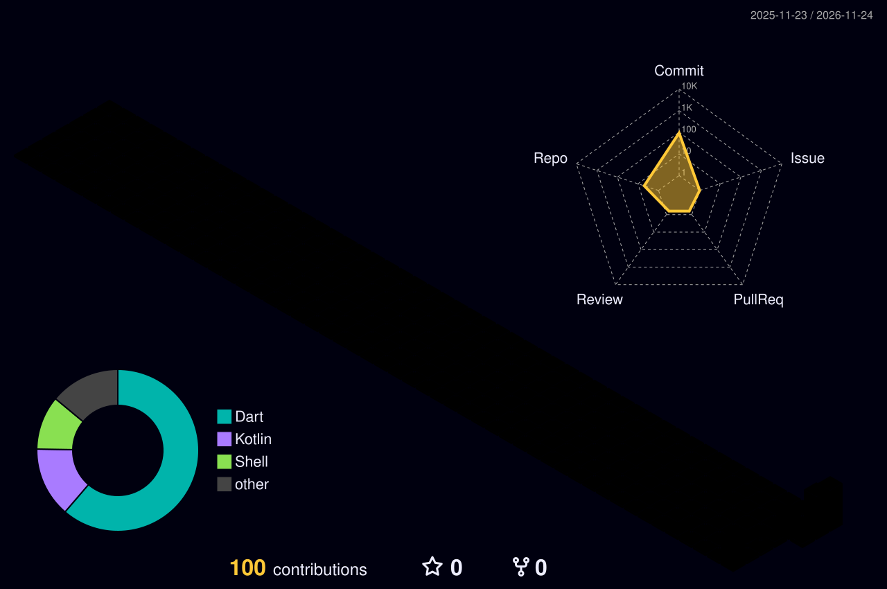

  

---

## ⚡ About Me

<table>
<tr>
<td width="60%" valign="top">

🔭 **Currently Building**  
[**Poswal Orbit**](https://github.com/officialtofeekposwal/poswal-orbit) & [**Poswal Noor**](https://github.com/officialtofeekposwal/PoswalNoor)

🌱 **Learning & Exploring**  
Low-level Android systems, Kotlin 2.x & High-Performance Dart

💬 **Ask Me About**  
Flutter, Android, Dart, Kotlin, SQLite, Local Architecture & State Management

📫 **Reach Me**  
[workwithtofeek@gmail.com](mailto:workwithtofeek@gmail.com)

⚡ **Fun Fact**  
I build apps that run 100% offline, without even asking for internet permission!

</td>
<td width="40%" align="center" valign="middle">

</td>
</tr>
</table>

---

## 🚀 Featured Projects

| Project | What it is | Stack | Status |
| :-- | :-- | :-- | :-: |
| 🪐 [**Poswal Orbit**](https://github.com/officialtofeekposwal/poswal-orbit) | Offline-first daily productivity OS (Habits, Tasks, Notes) with 100% local SQLite and **184 passing tests** | `Flutter` `Dart` `SQLite` `Riverpod` | 🟢 Active |
| 🌙 [**Poswal Noor**](https://github.com/officialtofeekposwal/PoswalNoor) | Privacy-first offline Islamic utility app with precise offline prayer calculations and zero trackers | `Flutter` `Clean Architecture` | 🟢 Active |

---

## 🧠 Core Engineering Principles

| 📴 Offline-First | 🧪 Test-Driven | ⚡ Zero-Bloat |
| :-: | :-: | :-: |
| The local device is the primary database. User data is never trapped. | Strict unit and widget tests before anything ships. | Native speed, minimal dependencies, clean architecture. |

---

## 🛠️ Tech Arsenal

**📱 Mobile & Languages**

**🎨 Frontend & UI**

**🗄️ Backend, Databases & DevOps**

---

## 🌐 My Contributions in 3D

<!-- Generated automatically by the GitHub Action in .github/workflows/profile-3d.yml -->

---

## 🐍 Contribution Snake

<picture>
  <source media="(prefers-color-scheme: dark)" srcset="https://raw.githubusercontent.com/officialtofeekposwal/officialtofeekposwal/output/github-snake-dark.svg" />
  <source media="(prefers-color-scheme: light)" srcset="https://raw.githubusercontent.com/officialtofeekposwal/officialtofeekposwal/output/github-snake.svg" />
  
</picture>

---

## 📊 Stats & Activity

 

 

---

## 🤝 Let's Connect

  

<i>"Your data belongs on your device." 📴</i>

