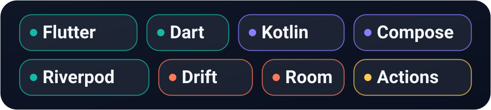

<h1 align="center">
<picture>
<source media="(prefers-color-scheme: dark)" srcset="assets/hero-dark.svg">

</picture>
</h1>

I build offline-first Android apps that keep your data on your device.

<a href="#about">About</a> ·
<a href="#projects">Projects</a> ·
<a href="#stack">Stack</a> ·
<a href="#how-i-work">How I work</a> ·
<a href="#contact">Contact</a>

## About

I make Android apps that work without an account and without a network. My two main projects are Poswal Orbit, a habit, task and note app, and Poswal Noor, an offline Islamic reference app. Both store everything on the phone.

I am currently building both of them, and learning Android system internals and Kotlin 2.x.

Ask me about Flutter, Dart, Kotlin, Android, SQLite, local-first design and state management.

## Projects

### Poswal Orbit

Habits, tasks and notes in one offline Android app. Habits are the inner orbit, tasks the outer one, and notes hold the day together.

- Built with Flutter and Dart. State is handled with Riverpod and data is stored with Drift (SQLite).
- The day starts at 4:00 AM by default, so a check-in after midnight counts for the day before.
- Habits have a consistency score and an optional streak freeze. Tasks accept plain sentences such as "Pay rent tomorrow 4pm".
- English, Hindi and Urdu, with a right-to-left layout and bundled fonts.
- No accounts and no analytics. Release builds do not request the `INTERNET` permission. Debug and CI test builds may.
- Automated tests run in CI. Text colors are tested for WCAG AA contrast.

**Status.** Android builds are made by CI. Verification on real phones is in progress. iOS code is written but not verified, because I have no Mac. It is not on the Play Store. To try it, follow the [CI debug build steps](https://github.com/officialtofeekposwal/poswal-orbit/blob/main/docs/INSTALL_DEBUG_APK.md).

[Repository](https://github.com/officialtofeekposwal/poswal-orbit) · MIT license

### Super Apple Design

A set of instructions for AI coding tools. A skill is a Markdown file that a tool such as Claude Code or Cursor reads before it starts work.

- Two skills: `apple-design-universal`, design rules rewritten in my own words from Apple's Human Interface Guidelines, and `design-workflow`, a four-phase routine of direction, build, test and review.
- A Cursor rule file, and an `AGENTS.md` file for Codex and Windsurf.
- An install script that copies the skills into the right folder for each tool. With `--with-upstream` it also clones seven skills from their original authors. Their code is not copied into this repository.
- Not affiliated with Apple. No tagged release yet.

[Repository](https://github.com/officialtofeekposwal/super-apple-design) · MIT license

### Poswal Noor

An offline Islamic reference app for Android, written in Kotlin with Jetpack Compose and Material 3.

- The Quran: 6,236 ayahs in 114 surahs, in Arabic with English, Hindi and Urdu translations.
- Hadith: 14,060 records from Sahih al-Bukhari and Sahih Muslim.
- Prayer times are calculated on the device for a built-in list of 38 cities, with a standard or Hanafi Asr setting. The Qibla compass uses the phone's rotation sensor.
- Dhikr and tasbih tools, a Hijri calendar and home screen widgets.
- The app's own manifest declares no permissions, so it does not request `INTERNET`.
- `DATA_SOURCES.md` lists where each text comes from and its license. A few items are marked unverified there.

[Repository](https://github.com/officialtofeekposwal/PoswalNoor) · MIT license

## Stack

These are the technologies that appear in the three repositories above.

- **Flutter and Dart:** Poswal Orbit.
- **Kotlin and Jetpack Compose:** Poswal Noor. Orbit's Android widget code is also Kotlin.
- **Riverpod:** state management in Orbit.
- **Drift and Room:** SQLite access in Orbit and Noor.
- **GitHub Actions:** build, test and release workflows in Orbit.

Also in these repositories

- Hilt, Paging 3 and Glance in Noor.
- go_router and home_widget in Orbit.
- Python scripts that build Noor's content database.
- Swift in Orbit's iOS widget code. It has not been verified on a device.

## How I work

- **Keep data on the device.** Both apps store everything locally and work without a network.
- **Test the logic that matters.** In Orbit, streaks, scores, schedules and quick add are plain Dart with automated tests, run in CI.
- **Say what is verified.** Orbit's repository states plainly that iOS has not been verified.
- **Keep the interface calm.** Sentence-case text, no emoji in the app, and support for reduced motion.

## Contact

- GitHub: [officialtofeekposwal](https://github.com/officialtofeekposwal)
- Questions or bugs: open an issue on [Poswal Orbit](https://github.com/officialtofeekposwal/poswal-orbit/issues) or [Poswal Noor](https://github.com/officialtofeekposwal/PoswalNoor/issues)
- Email: [workwithtofeek@gmail.com](mailto:workwithtofeek@gmail.com)
- Instagram: [officialtofeekposwal](https://instagram.com/officialtofeekposwal)
